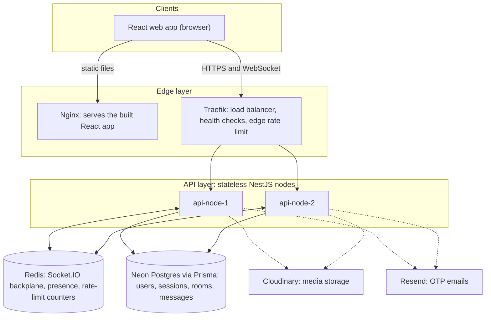
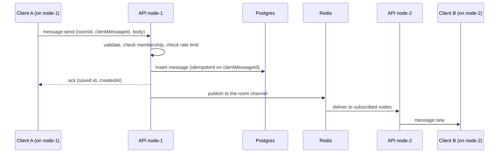
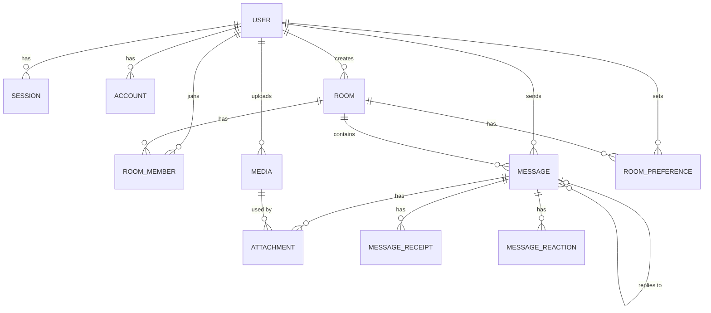

# Kyu Chatter

A real-time chat application built as a **distributed system**: several stateless server nodes sit behind a load
balancer, share state through Redis and Postgres, and keep working when one node dies.

If you have never contributed to a project like this, start with
[Contributing](#contributing) and the [good first tasks](#good-first-tasks).

> **System Status:** The backend API and real-time distributed engine are **fully implemented**.
> All endpoints and WebSocket events are backed by Prisma ORM connected to Neon Postgres, Better Auth sessions,
> atomic Redis rate limiting and presence tracking, and cross-node pub/sub via Redis. See [Project status](#project-status).

---

## Table of contents

1. [What it does](#what-it-does)
2. [Project status](#project-status)
3. [Architecture (top to bottom)](#architecture-top-to-bottom)
4. [Tech stack](#tech-stack)
5. [Data model](#data-model)
6. [Repository structure](#repository-structure)
7. [Getting started](#getting-started)
8. [Working with the API](#working-with-the-api)
9. [Contributing](#contributing)
10. [Troubleshooting](#troubleshooting)
11. [Roadmap](#roadmap)

---

## What it does

- Sign in with an email one-time code (OTP) and/or passwords.
- Group rooms and private 1-to-1 chats.
- Real-time messages, typing indicators and online/offline status over WebSockets.
- Replies, edits, soft-deletes, emoji reactions and read tracking.
- Image, video and file sharing (direct-to-Cloudinary/Cloudflare uploads).
- Two or more server nodes: kill one, clients reconnect to another and catch up on missed messages.

## Project status

| Area | State |
|---|---|
| Database schema and migrations (Neon + Prisma) | **Done** |
| REST routes, request DTOs (validation), response shapes | **Done** |
| Global pipe, response envelope, error filter, logging | **Done** |
| Swagger UI and `docs/API.md` | **Done** |
| WebSocket gateway (real-time chat, presence, typing, read receipts) | **Done** |
| Service logic (Prisma queries, permission checks) | **Done** |
| Authentication (Better Auth + Google OAuth + password + session cookies/tokens) | **Done** |
| OTP email sending (Resend) | **Done** |
| Guards, rate limiting, security middleware | **Done** (`AuthGuard`, `RoomMemberGuard`, `RoomAdminGuard`, `RoomOwnerGuard`, `WsAuthGuard`, `WsThrottleGuard`, `helmet`) |
| Redis (Socket.IO adapter, presence, rate-limit counters) | **Done** |
| Docker Compose, Traefik load balancer, two-node failover | **Done** |
| Frontend (React) | **Done** (`apps/frontend`) |

## Architecture (top to bottom)

> This section describes the system design. All backend components are fully implemented and verified against the live database and Redis cluster. Check [Project status](#project-status) for the status overview.

### The big picture



Read it from the top:

1. **Clients** (the React app) load static files from Nginx, then talk to the API through Traefik only.
2. **Edge layer.** Traefik spreads requests and WebSocket connections across the API nodes, removes a node from
   rotation when its `/health/ready` check fails, and applies a first, coarse rate limit. Nginx only serves the
   built frontend.
3. **API layer.** Every node runs the same NestJS code and keeps **no state in memory** that another node would
   need: no room membership, no sessions, no presence, no counters. Any node can serve any user.
4. **Shared state.** Two stores hold everything that must survive or be shared:
   - **Redis** carries real-time traffic between nodes (Socket.IO Redis adapter), online/offline presence, and
     rate-limit counters.
   - **Postgres (Neon)** is the source of truth: accounts, sessions, rooms, memberships, messages, media records.
5. **External services.** Cloudinary stores uploaded files; Resend delivers the OTP emails.

### Inside one API node: the request pipeline

```
Request
  -> Global ValidationPipe        reject unknown or invalid fields (DTOs)
  -> Controller                   routing only, no business logic
  -> Service                      business rules + Prisma queries
  -> TransformResponseInterceptor wraps { success, data, meta: { nodeId, timestamp } } + X-Node-Id header
  -> Response

Any thrown error
  -> AllExceptionsFilter          uniform { success: false, error: {...} }, Prisma errors mapped (409, 404)
```

Auth routes (`/api/auth/*`), health routes and Swagger skip the envelope.

### Flow 1: sending a message across nodes



Rules that make this safe:
- **Persist first, then broadcast.** A message is never announced before it is saved.
- **Idempotent sends.** The client invents a `clientMessageId`. A unique index on
  `(roomId, senderId, clientMessageId)` means a retry after a dropped connection can never create a duplicate.
- Every message stores the `nodeId` that handled it, so the UI can show which node served a message during demos.

### Flow 2: a node dies (failover)

1. Traefik's health check fails for `node-1` and stops routing to it.
2. Socket.IO clients on `node-1` lose their connection and auto-reconnect (with backoff) to `node-2`.
3. The session cookie is validated against Postgres, so **no re-login** is needed.
4. The client calls the resync endpoint/event with the last message id it saw per room and receives everything it
   missed from Postgres. Nothing is lost because messages were persisted before being broadcast.
5. Presence uses a Redis sorted set with expiry times, so users from the dead node expire to "offline" on their own.

### Flow 3: signing in (email OTP)

1. The user enters an email. Better Auth generates a short-lived code and calls our mail function (Resend).
2. The user submits the code. Better Auth creates a session row in Postgres and sets a cookie.
3. Every HTTP request and the WebSocket handshake read that cookie. Because sessions live in the database,
   any node can authenticate any user.

### Flow 4: presence and typing

- **Presence:** each socket heartbeats into a Redis sorted set `presence:{userId}`. A user is online if any
  non-expired entry exists. When the last socket leaves, `lastSeenAt` is written to Postgres.
- **Typing:** short-lived events broadcast through the Redis adapter. They are never written to the database.

### Flow 5: media uploads

1. Client asks `POST /api/media/signature`, the API creates a `Media` row (`UPLOADING`) and returns a signed
   Cloudinary upload.
2. Client uploads **directly to Cloudinary** (file bytes never pass through our servers).
3. Client calls `POST /api/media/:id/confirm`; the API verifies it and marks the media `READY`.
4. The media id is attached to a message through `mediaIds`.

### Layers of rate limiting

| Layer | What it protects | Status |
|---|---|---|
| Traefik / Nginx | Floods of raw requests at the edge | Active (Traefik middleware) |
| `@nestjs/throttler` (Redis-backed) | HTTP routes per IP, with tighter limits on OTP routes | Implemented (`RedisThrottlerStorage`) |
| WebSocket throttle guard (Redis counters) | Message and typing spam per user and event | Implemented (`WsThrottleGuard` with atomic Redis Lua script) |
| Better Auth rate limiting | Sign-in and OTP abuse | Implemented (Better Auth rate limit plugin) |

### Design principles

1. Nodes are stateless; shared state lives in Redis or Postgres.
2. Persist, then broadcast.
3. Every write that can be retried is idempotent.
4. Reconnect always ends with a resync from the database.
5. Never trust the client: user ids come from the session, never from request bodies, and every room action checks
   membership.

## Tech stack

| Layer | Technology |
|---|---|
| Frontend | React 19, React Router (SPA), Tailwind CSS 4, shadcn/ui (Radix), TanStack Query, Zustand, Socket.IO Client |
| Backend | NestJS 12, TypeScript (ESM) |
| Realtime | Socket.IO (WebSocket transport), Redis adapter |
| Auth | Better Auth (email OTP), `@thallesp/nestjs-better-auth` |
| Database | Neon Postgres, Prisma ORM 7 (`@prisma/adapter-pg`) |
| Validation | class-validator, class-transformer |
| Email | Resend (OTP only) |
| Media | Cloudinary (signed direct uploads) |
| Edge / infra | Traefik, Nginx, Docker Compose |
| Tooling | pnpm, Vitest, oxlint, Prettier, Swagger |

## Data model



Key ideas:
- **User ↔ Room is many-to-many** through `RoomMember` (role: `OWNER`, `ADMIN`, `MEMBER`; plus a `lastReadMessageId` read cursor).
- A **direct message** is a `Room` with `type = DIRECT`, exactly two members and a unique `directKey` (the two user ids
  sorted and joined with `:`), which guarantees one DM per pair.
- `Message.clientMessageId` is the idempotency key; `Message.nodeId` records which server handled it; messages are
  soft-deleted via `deletedAt`.
- `Media` records an upload (`UPLOADING`, `READY`, `FAILED`); `Attachment` links media to a message.
- **Not in the database:** presence, typing state, socket ids and rate-limit counters. These live in Redis.
- Better Auth owns `user`, `session`, `account` and `verification`. **User ids are random strings, not UUIDs.**
  Room, message and media ids are time-ordered UUIDs (v7).

The full schema is in [`apps/backend/prisma/schema.prisma`](apps/backend/prisma/schema.prisma).

## Repository structure

```
.
├─ apps/                         The two applications
│  ├─ backend/                   NestJS API + WebSocket server (stateless, horizontally scalable)
│  │  ├─ prisma/
│  │  │  ├─ schema.prisma        Single source of truth for all database tables
│  │  │  └─ migrations/          Applied SQL migrations
│  │  ├─ prisma.config.ts        Prisma CLI config: schema path and direct Neon URL
│  │  ├─ src/
│  │  │  ├─ main.ts              App bootstrap: CORS, Swagger, port, env loading, helmet
│  │  │  ├─ app.module.ts        Root module wiring all feature modules
│  │  │  ├─ common/              Code shared by every feature
│  │  │  │  ├─ common.module.ts  Registers the global pipe, interceptors and exception filter
│  │  │  │  ├─ decorators/       @CurrentUser() and @Public()
│  │  │  │  ├─ dto/              Shared DTOs: pagination, id params, trimString helper
│  │  │  │  ├─ filters/          AllExceptionsFilter: uniform error responses
│  │  │  │  ├─ guards/           AuthGuard, RoomMemberGuard, RoomAdminGuard, RoomOwnerGuard, WsAuthGuard, WsThrottleGuard
│  │  │  │  ├─ interceptors/     Response envelope + X-Node-Id header, request logging
│  │  │  │  └─ utils/            Helpers: getNodeId(), socket-user.util.ts
│  │  │  ├─ config/              Environment validation via Joi schema
│  │  │  ├─ prisma/              PrismaService/PrismaModule: pooled Neon Postgres connection
│  │  │  ├─ auth/                Better Auth integration (email/password/Google) and AuthModule
│  │  │  ├─ mail/                OTP email sending via Resend
│  │  │  ├─ users/               Profile management, user search, public profiles (Prisma-backed)
│  │  │  ├─ rooms/               Group/DM rooms, member management, roles, read cursors (Prisma-backed)
│  │  │  ├─ messages/            Idempotent send, pagination, soft-delete, resync, reactions (Prisma-backed)
│  │  │  ├─ media/               Signed upload requests, confirmation, media metadata
│  │  │  ├─ chat/                Socket.IO gateway, presence (Redis sorted sets), typing indicators
│  │  │  │  └─ dto/ws/           Payload shapes for each socket event
│  │  │  ├─ realtime/            RedisService, RedisIoAdapter (cross-node pub/sub), RedisThrottlerStorage
│  │  │  ├─ health/              /health/live, /health/ready (db & redis checks), /health/node, /ping
│  │  │  └─ generated/prisma/    Generated Prisma client (`pnpm prisma generate`)
│  │  ├─ test/                   Vitest unit/integration tests and modular load-test harness
│  │  │  └─ load/                Distributed load test runner, statistics engine, results harness
│  │  ├─ .env.example            Template for local environment configuration
│  │  └─ Dockerfile              Multi-stage production container build
│  └─ frontend/                  React Router (SPA) + Tailwind CSS 4 web client
│     ├─ app/
│     │  ├─ routes/              Flat routes: auth (login/signup), chat layout, chat.$roomId
│     │  ├─ features/            Feature domains: auth, rooms, messages, realtime, presence, users, media
│     │  ├─ components/          Radix/shadcn ui/, layout shell & sidebar, state feedback views
│     │  ├─ providers/           Theme, WebSocket realtime lifetime, global dialog drawers
│     │  ├─ hooks/ & lib/        Reusable hooks, Axios API client, TanStack Query keys
│     │  ├─ root.tsx & routes.ts Application root shell and route definitions
│     │  └─ styles.css           Tailwind CSS 4 styles
│     ├─ package.json            Dependencies and frontend scripts
│     └─ vite.config.ts          Vite + React Router bundler configuration
├─ docs/
│  ├─ API.md                     Full REST + WebSocket contract
│  ├─ DEPLOYMENT.md              Production deployment guide
│  └─ LOAD-TEST.md               Load testing, metrics, failover simulation guide
├─ infra/                        Traefik dynamic and static configuration
├─ docker-compose.yml            Multi-node stack: Redis, api-1, api-2, Traefik load balancer
├─ package.json                  Root manifest: pnpm workspace
└─ README.md                     You are here
```

Every backend feature folder follows the same pattern:

```
rooms/
├─ rooms.module.ts        Declares the controller and service
├─ rooms.controller.ts    HTTP routes only: bind DTOs, call the service, set status codes
├─ rooms.service.ts       Business logic and database access
└─ dto/
   ├─ *.dto.ts            Request DTOs: input validation with class-validator
   └─ *.response.ts       Response shapes returned to the frontend
```

## Getting started

### Prerequisites

- **Node.js 22.13+** (check with `node --version`)
- **pnpm 11.6+** (`pnpm --version`). Install: <https://pnpm.io/installation>. This repo uses pnpm only; do not use npm or yarn.
- **A Postgres database on [Neon](https://neon.tech)** (free). Either ask a maintainer for a shared dev database URL, or create your own free project.
- **Redis** and **Docker**: required for multi-node clustering and distributed rate limiting (`docker compose up -d`). For local single-node dev, a local Redis server or container running on `localhost:6379` is used.

### 1. Clone and branch

```bash
git clone <repo-url>
cd Kyu_chatter
git switch -c feat/my-first-change
```

### 2. Backend

```bash
cd apps/backend
cp .env.example .env        # then fill in the values below
pnpm install
pnpm prisma generate        # creates src/generated/prisma (required before building)
pnpm prisma migrate deploy  # applies the existing migrations to your database
pnpm start:dev              # http://localhost:3000, auto-reloads
```

If pnpm prints a warning about ignored build scripts, run `pnpm approve-builds` and approve the Prisma packages.

**Environment variables** (`apps/backend/.env`, never commit this file):

| Variable | Needed | Purpose |
|---|---|---|
| `DATABASE_URL` | required | Neon **pooled** connection string, used by the running app |
| `DIRECT_URL` | required | Neon **direct** (unpooled) string, used by Prisma migrations |
| `REDIS_URL` | required | Redis connection URL (`redis://localhost:6379`) for pub/sub, presence, throttling |
| `PORT` | optional | Server port (default 3000) |
| `NODE_ID` | optional | Name of this node, e.g. `node-1`; shown in the `X-Node-Id` header |
| `ALLOW_DEV_USER_HEADER` | dev only | `true` lets you test without logging in (development only) |
| `FRONTEND_URL` | optional | Frontend origin for CORS, e.g. `http://localhost:5173` |
| `BETTER_AUTH_SECRET` | required | Random secret (`openssl rand -base64 32`); identical on every node |
| `BETTER_AUTH_URL` | required | Public base URL of the API |
| `RESEND_API_KEY`, `MAIL_FROM` | optional | Resend credentials for OTP email delivery |
| `CLOUDINARY_CLOUD_NAME`, `CLOUDINARY_API_KEY`, `CLOUDINARY_API_SECRET` | optional | Cloudinary credentials for signed media uploads |

### 3. Frontend

The web app is a React 19 single-page application built with React Router, Tailwind CSS 4, shadcn/ui components, TanStack Query, Zustand, and Socket.IO client.

```bash
cd apps/frontend
cp .env.example .env        # configure VITE_API_BASE_URL
pnpm install
pnpm dev                    # starts dev server on http://localhost:5173
```

**Environment variables** (`apps/frontend/.env`):

| Variable | Needed | Purpose |
|---|---|---|
| `VITE_API_BASE_URL` | required | Backend base URL (`http://localhost:8080` behind Traefik or `http://localhost:3000` direct) |

**Development Login:**
When the backend runs with `ALLOW_DEV_USER_HEADER=true` (development mode), the frontend sign-in page (`/auth/login`) provides a **Dev Login** box allowing one-click authentication as any existing user ID without password or OTP entry.

### 4. Check that it works

```bash
curl localhost:3000/health/node
curl -H "x-dev-user-id: test-user" localhost:3000/api/users/me
```

Open <http://localhost:3000/api/docs> for the interactive Swagger UI.

### Useful commands (run in `apps/backend`)

| Command | What it does |
|---|---|
| `pnpm start:dev` | Run the API with auto-reload |
| `pnpm build` | Compile to `dist/` |
| `pnpm test` | Run unit tests (Vitest) |
| `pnpm lint` | Lint with oxlint |
| `pnpm format` | Format with Prettier |
| `pnpm prisma generate` | Regenerate the Prisma client after any schema change |
| `pnpm prisma migrate dev --name <what-changed>` | Create and apply a new migration (use a dev database) |
| `pnpm prisma studio` | Browse your database in the browser |
| `pnpm nest g mo\|co\|s <name> --no-spec` | Generate a Nest module, controller or service |
| `pnpm load:test` | Run distributed load testing and failover verification harness |

### Useful commands (run in `apps/frontend`)

| Command | What it does |
|---|---|
| `pnpm dev` | Run the React web client with HMR (`http://localhost:5173`) |
| `pnpm build` | Run React Router typegen, compile TypeScript, and build client bundle |
| `pnpm start` | Preview the production build locally via Vite preview |
| `pnpm typecheck` | Run React Router typegen and verify TypeScript types |
| `pnpm lint` | Lint with ESLint |
| `pnpm lint:fix` | Automatically resolve ESLint formatting and rule warnings |

## Working with the API

- **Contract:** [`docs/API.md`](docs/API.md) lists every route, its request fields and constraints, response shape and
  error format. **Swagger UI** at `/api/docs` lets you try routes live.
- **Envelope:** successful responses look like `{ "success": true, "data": ..., "meta": { "nodeId", "timestamp" } }`.
  Errors look like `{ "success": false, "error": { "statusCode", "message", "details?", "path", "timestamp" } }`.
- **Testing in development:** Set `ALLOW_DEV_USER_HEADER=true` (with `NODE_ENV !== 'production'`) and send
  `x-dev-user-id: <user-id>` (the user must exist in the `user` table). In production environments, dev authentication
  is strictly rejected and authentic sessions via Better Auth cookies/tokens are required.
- **Routes live under `/api/...`** (for example `/api/rooms`). `/api/auth/*` belongs to Better Auth. Health routes are
  at `/health/*`. `/ping` answers GET, HEAD and OPTIONS with a `SELECT 1` (200/204, or 503 if the database is down)
  for uptime monitors such as UptimeRobot.

## Contributing

Everyone is welcome, including first-timers. The workflow is the same for every change.

### 1. Pick a task

Browse the [good first tasks](#good-first-tasks) above or open an issue/PR for upcoming frontend features, seed scripts, or documentation additions. Tell the team which one you are taking so work is coordinated.

### 2. Create a branch

Use `type/short-description`, lowercase with hyphens:

```bash
git switch main && git pull
git switch -c feat/my-new-feature
```

Types: `feat/` new functionality, `fix/` bug fix, `chore/` housekeeping, `docs/` documentation, `refactor/` restructuring.
One branch per task. Small branches are easier to review and merge.

### 3. Add or modify service logic (worked example)

Say you are extending a method in `RoomsService`:

1. Open `apps/backend/src/rooms/rooms.service.ts`.
2. Inject dependencies: `constructor(private readonly prisma: PrismaService) {}` (import with `.js` suffix).
3. Execute real Prisma queries. Wrap multi-step writes in `this.prisma.$transaction(...)`.
4. Keep the return value matching the response type in `dto/room.response.ts`. If you must change a response or request
   shape, update the DTO **and** `docs/API.md` in the same pull request, because the frontend depends on it.
5. Enforce authorization rules (membership checks, admin privileges).
6. Add or update a Vitest test in `*.spec.ts`.
7. Run `pnpm build && pnpm lint && pnpm test`.

### 4. Commit

Use short messages in the form `type(scope): what changed`:

```bash
git add -A
git commit -m "feat(rooms): implement get-or-create direct room"
```

### 5. Open a pull request

```bash
git fetch origin
git rebase origin/main            # or: git merge origin/main
git push -u origin feat/rooms-create-group
```

Then open a pull request on GitHub (or `gh pr create --base main`). In the description, say what changed, anything
reviewers must do after pulling (for example `pnpm install` or new environment variables), and anything left unfinished.
Ask a teammate to review. Merge when it builds and tests pass.

### Pull request checklist

- [ ] `pnpm build`, `pnpm lint` and `pnpm test` pass in the app you touched
- [ ] No `.env` files, secrets, `node_modules/`, `dist/` or `src/generated/` committed
- [ ] New request fields have class-validator decorators
- [ ] Contract changes are reflected in `docs/API.md`
- [ ] Prisma schema changes include a new migration in `prisma/migrations/`
- [ ] No OTP codes, tokens, cookies or message bodies written to logs

### Code conventions

- **pnpm only.** Run commands from inside the app folder you are working on.
- **ESM imports must end in `.js`**, even for TypeScript files: `import { RoomsService } from './rooms.service.js'`.
  Forgetting this is the most common build error.
- **Use the Nest CLI** (`pnpm nest g ...`) for new modules, controllers and services so they are registered for you.
- **Controllers stay thin.** Routing, DTO binding and status codes only. Logic and database access belong in services.
- **Always validate input** with a DTO. Never read a `userId` from a request body; use `@CurrentUser('id')`.
- **User ids are strings** (validate with `@IsString()`); **room, message and media ids are UUIDs** (`@IsUUID('all')`).
- **Never edit a migration that has been applied.** Change `schema.prisma` and create a new migration instead.
- **Never use raw SQL built from strings.** Use Prisma queries (or the tagged `$queryRaw`).
- **Do not store state in server memory.** If another node would need it, it belongs in Redis or Postgres.
- **Persist first, then broadcast** for anything real-time.
- Do not install `npm`/`yarn` lockfiles, and do not add dependencies without mentioning why in the pull request.

### Good first tasks

| Difficulty | Task | Status |
|---|---|---|
| Beginner | Fill in `HealthController.getReady` with real database and Redis ping checks | **Done** |
| Beginner | Implement `UsersService.getMe`, `updateMe`, `getProfile` and `search` with Prisma | **Done** |
| Beginner | Add a Prisma seed script that creates demo users and rooms | Open |
| Beginner | Improve `docs/API.md` with example requests and responses | **Done** |
| Beginner | Frontend: login page with email + OTP / password and dev login | **Done** (`apps/frontend`) |
| Intermediate | Implement `RoomsService` (create group, get-or-create DM, list with unread counts, membership checks) | **Done** |
| Intermediate | Implement `MessagesService` (cursor pagination, idempotent send, soft delete, resync) | **Done** |
| Intermediate | Frontend: room list, chat view and a Socket.IO client hook with reconnect and resync | **Done** (`apps/frontend`) |
| Intermediate | Write the load-test script in `apps/backend/test/load/` and record latency numbers | **Done** |
| Advanced | Wire Better Auth (`auth.ts`, Nest module, session on the WebSocket handshake) | **Done** |
| Advanced | Socket.IO Redis adapter so messages cross nodes; presence with Redis sorted sets | **Done** |
| Advanced | WebSocket throttle guard and `@nestjs/throttler` with Redis storage | **Done** |
| Advanced | `docker-compose.yml` with Redis, two API nodes, Traefik health checks and reverse proxy | **Done** |

## Troubleshooting

| Problem | Likely cause and fix |
|---|---|
| `Cannot find module '../generated/prisma/client.js'` | Run `pnpm prisma generate` |
| `Cannot find module './something'` at runtime | Missing `.js` suffix on a relative import |
| `command not found: pnpm` | Install pnpm and restart your terminal (fish users: add the pnpm `bin` folder with `fish_add_path`) |
| POST/PATCH bodies arrive empty or fail validation | The body parser is disabled in `main.ts` (`bodyParser: false`) before Better Auth is registered; keep them in sync |
| Database connection hangs or `ENETUNREACH` | Neon over IPv6; `main.ts` already prefers IPv4, make sure `.env` is loaded and the URL is correct |
| `prisma migrate dev` complains about a shadow database | Use a dedicated dev Neon branch, or use `pnpm prisma migrate deploy` to apply existing migrations |
| Build scripts ignored warning from pnpm | Run `pnpm approve-builds` |
| Browser blocks API calls | Set `FRONTEND_URL` to the exact frontend origin and restart the API |

## Roadmap

1. [x] Real service logic for users, rooms and messages (Prisma queries and transactional writes).
2. [x] Better Auth with email OTP/passwords; session on HTTP and WebSocket handshake.
3. [x] Socket.IO gateway with Redis adapter: cross-node broadcast, presence, typing, read receipts.
4. [x] Guards, rate limiting, and security hardening (`helmet`, atomic Redis throttle, room member checks).
5. [x] Docker Compose with Traefik load balancer and two-node failover.
6. [x] Frontend: auth, room list, chat view, media upload (`apps/frontend`).
7. [x] Distributed load test harness and failover benchmarks (`apps/backend/test/load/`, `docs/LOAD-TEST.md`).

## License

Academic project. A license has not been chosen yet; until one is added, all rights are reserved by the contributors.